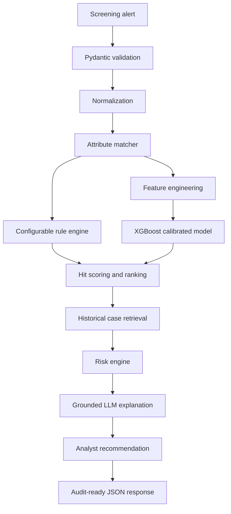

# AI-Assisted Alert Analysis

FastAPI prototype for AI-assisted sanctions, embargo, PEP, and watchlist alert investigations.

This system is an analyst-assistance tool. It does not replace Neterium, Firco, STPA, STA, or any screening engine, and it does not make autonomous final compliance decisions. The API returns recommendations, supporting evidence, confidence, risk level, and audit metadata for human analyst review.

## Architecture



## Technology Stack

- Python 3.12, FastAPI, Pydantic v2
- SQLAlchemy 2, Alembic, PostgreSQL 16, pgvector
- Redis-ready configuration
- RapidFuzz string matching and optional `sentence-transformers` embeddings
- XGBoost classifier calibrated with `CalibratedClassifierCV`
- Pytest, Ruff, Black, MyPy
- Docker and Docker Compose

## Project Layout

```text
app/
  api/v1/              FastAPI routes
  core/                config, security, logging, errors
  models/              SQLAlchemy models
  schemas/             Pydantic request/response contracts
  services/            matching, rules, ML, ranking, risk, LLM
  repositories/        prototype persistence layer
  utils/               normalization, similarity, masking, hashing
ml/
  generate_dataset.py  synthetic training data
  feature_engineering.py
  train.py             XGBoost + calibration
  evaluate.py
  predict.py
rules/
  matching_rules.yaml  configurable weights, thresholds, priorities
tests/
```

## Run Locally

```bash
python -m venv .venv
.venv\Scripts\activate
pip install -r requirements.txt
python scripts/seed_data.py
uvicorn app.main:app --reload
```

Open:

- Swagger: http://localhost:8000/docs
- Health: http://localhost:8000/health

## Docker

```bash
docker compose up --build
```

Services:

- `api` on port `8000`
- `postgres` with pgvector on port `5432`
- `redis` on port `6379`

## Train the Model

Recommended path: train in Google Colab and run the API locally. This keeps laptop resource use low while still producing the same model artifact the API expects.

Open:

```text
notebooks/train_colab.ipynb
```

In Colab, run the notebook cells to generate synthetic data, train/calibrate XGBoost, evaluate metrics, and export artifacts to Google Drive. Copy these files back into the local project:

```text
ml/models/entity_matcher.joblib
ml/metrics/entity_matcher_metrics.json
```

Local training is also supported for smaller runs:

```bash
python -m ml.generate_dataset --rows 10000
python -m ml.train
python -m ml.evaluate
```

The model artifact is written to:

```text
ml/models/entity_matcher.joblib
```

Metrics are written to:

```text
ml/metrics/entity_matcher_metrics.json
```

The API separates:

- screening engine score
- calibrated model probability
- AI confidence
- risk level
- analyst final decision

## API Examples

Analyze:

```bash
curl -X POST http://localhost:8000/api/v1/alerts/analyze \
  -H "Content-Type: application/json" \
  -d @tests/fixtures/true_positive.json
```

Primary endpoints:

- `POST /api/v1/alerts/analyze`
- `GET /api/v1/alerts/{alertId}`
- `POST /api/v1/cases`
- `GET /api/v1/cases/{caseId}`
- `GET /api/v1/cases/similar/{alertId}`
- `POST /api/v1/feedback`
- `GET /api/v1/models`
- `GET /api/v1/rules`
- `PUT /api/v1/rules`
- `GET /health`
- `GET /ready`

## Security Notes

- API key auth can be enabled with `AUTH_ENABLED=true` and `API_KEY=...`.
- Sensitive identifiers are modeled as hashes in the database schema.
- Helper masking prevents plain-text passport, tax ID, and registration values from being logged.
- `.env.example` contains no secrets.

## Limitations

- The local LLM provider is deterministic and grounded; configure OpenAI or Azure OpenAI for hosted explanations.
- The prototype uses an in-memory repository for fast local demos while SQLAlchemy models and Alembic migrations define the production database shape.
- Sentence-transformer loading is disabled by default to avoid model downloads during tests; set `ENABLE_SENTENCE_TRANSFORMERS=true` to use `BAAI/bge-m3`.
- Synthetic data is useful for proving the pipeline, not for production model quality.
