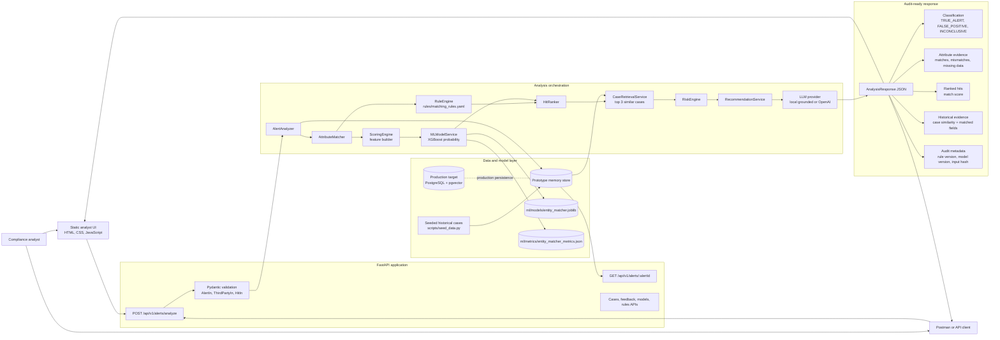

# AI-Assisted Alert Analysis Architecture

## Reading the Diagram

The main entry point is `POST /api/v1/alerts/analyze`. The API validates the alert payload, then `AlertAnalyzer` coordinates the full analysis pipeline.

The backend first compares the third party against each screening hit using `AttributeMatcher`. Those field-level results feed the rule engine and feature builder. The rule engine applies deterministic compliance logic, while `MLModelService` loads the trained XGBoost model and returns a match probability.

The hit ranker combines rule score, model probability, screening score, and historical similarity into a ranked hit list. Historical evidence is calculated by comparing the current third party against stored historical case third parties and returning the top three cases.

The LLM provider generates grounded reasoning text from already-computed evidence. It does not decide the final classification and does not override deterministic rules.

The output is an audit-ready JSON response with classification, confidence, risk level, ranked hits, attribute evidence, historical cases, reasoning, recommended actions, and audit metadata.
